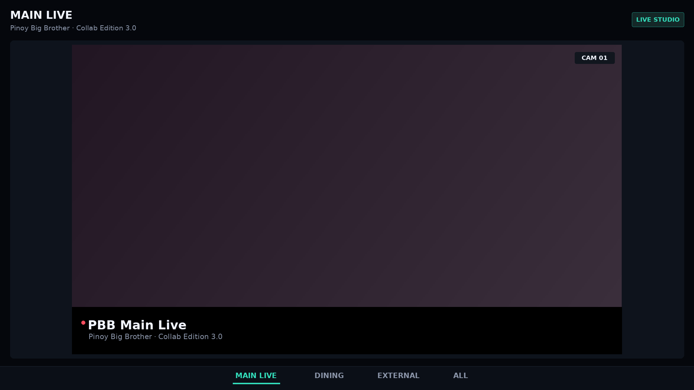
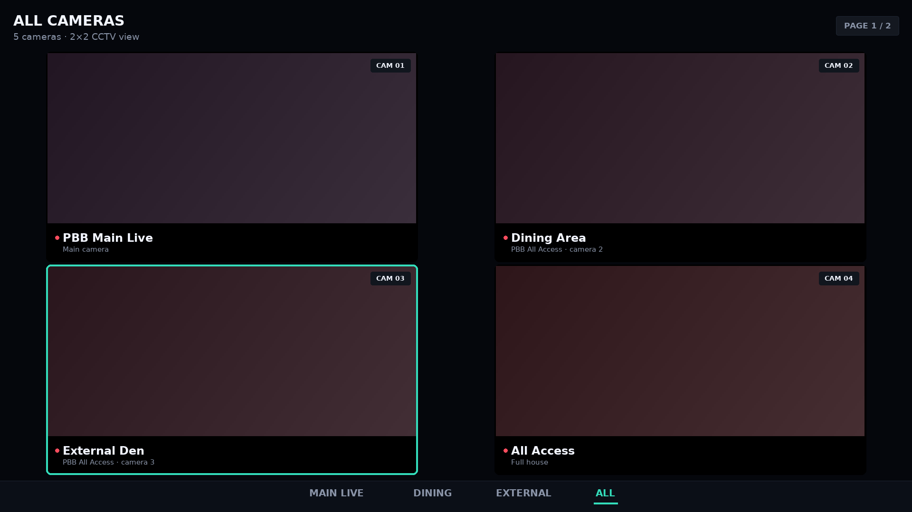
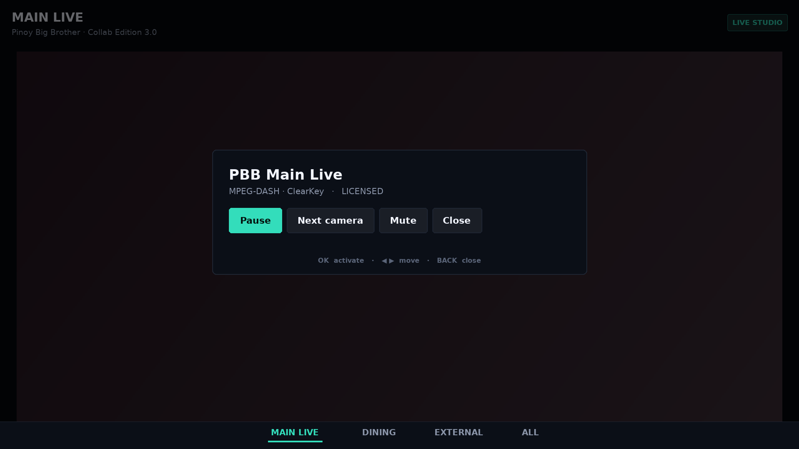

# PBB Live — Android TV multi-camera viewer

A native, remote-first Android TV app for the PBB Live camera feeds: **MAIN LIVE**, **DINING**,
**EXTERNAL** and an **ALL** CCTV wall. No WebView, no touch gestures, no ad/IAP SDKs — one activity,
one focus model, and honest states wherever a stream is missing or requires a licence.

| | |
|---|---|
| Package | `com.pbb.livetv` (debug builds: `com.pbb.livetv.debug`) |
| Version | 2.0.0 (versionCode 10) |
| Min / target SDK | 24 (Android 7.0 TV) / 35 |
| Language | Java 8 source level, Android framework only |
| APK size | ~190 KB signed, ~25 files, 1 dex |
| Permissions | `INTERNET`, `ACCESS_NETWORK_STATE` |
| Launcher | `LEANBACK_LAUNCHER` **and** `LAUNCHER`, 320×180 TV banner, landscape, leanback optional |

**Deliverables in this repo**

| File | What it is |
|---|---|
| [`pbb-live-tv-2.0.0-release.apk`](pbb-live-tv-2.0.0-release.apk) | **signed release APK** — install this on the TV (local debug key, see [Signing](#signing)) |
| [`pbb-live-tv-2.0.0-debug.apk`](pbb-live-tv-2.0.0-debug.apk) | debug APK (`com.pbb.livetv.debug`, installs side by side) |
| [`app/`](app) | complete Android Studio project (Gradle + offline build) |
| [`docs/streaming-architecture.md`](docs/streaming-architecture.md) | what the upstream `Pbb-Live-Stream` website actually does |
| [`docs/architecture.md`](docs/architecture.md) | how this app is built (classes, state machines, focus model) |
| [`docs/testing.md`](docs/testing.md) | what was verified here + the on-device test matrix |
| [`docs/img/`](docs/img) | layout mockups for each screen and focus state |

---

## 1. What the upstream repository does

`hanuramakuku/Pbb-Live-Stream` is a single-page web player. Full analysis in
[`docs/streaming-architecture.md`](docs/streaming-architecture.md); the essentials:

* `index.html` currently serves a **"System Update / Updating Live Feeds" maintenance card** — the
  player page is not live at the moment.
* `data.js` holds the channel table **obfuscated** (string-array shuffling). Decoded, `CH` is four
  entries: label, URL, `kid:key`, empty string.
* Every URL is **MPEG-DASH** on Akamai (`…akamaized.net/dash/live/2099522/…/manifest.mpd`) for
  *Main Live*, *Dining Area*, *External Den* and *All Access*.
* Playback in the original is **Shaka Player**, with the fourth field used as **ClearKey** licence
  material (the web player has it because the page is the broadcaster's own distribution).
* There is **no HLS, no MP4, no public API** in the repo, and no documented authorisation model
  beyond the ClearKey DRM itself.

**What that means for this app:** the camera list and sections come from that structure (one main
feed, dining, external, plus a combined view), but **no keys are shipped**. A DASH camera therefore
ships in the honest `Licence required` state until you supply licence material for a feed you are
authorised to rebroadcast. See [Configuring streams](#configuring-streams).

## 2. Screens

| Screen | Behaviour |
|---|---|
| **MAIN LIVE** (default on launch) | Big 16:9 player, auto-loads the main feed, section header, controls hidden while watching |
| **DINING** | Same player design; if the section has several feeds a camera strip appears above the picture |
| **EXTERNAL** | Same again, independent camera list |
| **ALL** | 2×2 CCTV wall with paged cameras (4 per page, `PAGE n / m`), per-tile labels and `CAM nn` badges, accent focus ring, OK = fullscreen, BACK = back to the wall with the same tile focused |




*(Layout mockups generated from the app's own design tokens — see `buildtools/make_mockups.py`.)*

## 3. Remote / D-pad model

| Where | Key | Action |
|---|---|---|
| Anywhere | ▲ ▼ ◀ ▶ | Move focus (never leaves the screen with nothing focused) |
| Player | **OK** | Show controls (Pause/Play, Next camera, Mute, Close) |
| All grid | **OK** | Open the focused camera fullscreen |
| All grid, page edge | ◀ ▶ | Previous / next page of cameras (when focus cannot move further) |
| All grid, fullscreen | **BACK** | Return to the wall, previous tile restored |
| Player | ▼ | Move into the section bar |
| Section bar | ◀ ▶ | **switch section** (owned by the bar, cannot jump into content) |
| Section bar | ▲ | Back to the content |
| Content | ◀ ▶ | Previous / next section |
| Anywhere | **BACK** | Controls → close; fullscreen → wall; then "Back to MAIN LIVE"; twice → exit |
| Play/Pause, Play, Pause, Stop media keys | | Playback control |
| Volume keys | | Left to the system (TV volume UI stays usable) |

Focus is always visible (accent border + 1.02–1.04× scale, 120–140 ms) and the nav bar shows the
selected section even when the content has focus.

## 4. Behaviour details

* **Launch** → MAIN LIVE, no onboarding, no menus. The last section and the last ALL camera are
  remembered (`pbb_livetv` SharedPreferences) and restored where practical.
* **Players** are keyed by camera id, created on demand, **reused** while visible and **released**
  the moment a camera leaves the screen. `onPause` pauses everything (no background audio);
  `onResume` resumes the visible camera only.
* **ALL** streams at most **four** cameras at once (one page), muted, with the focused camera
  audible only after you open it. No fake video: a camera with no URL renders "No stream
  configured", a keyless DASH camera renders "Licence required".
* **Errors** are surfaced with the reason and a Retry action (controls → Retry, or OK on the tile).
  HLS reconnects on its own with backoff; a playlist that keeps failing lands in the error state.
* **Offline** is detected before retrying (toast "No network connection"), so the UI never spins
  forever on a dropped Wi-Fi link.
* **Aspect ratio** is always 16:9 letterboxed (`TileLayout.fit16x9`), never stretched.

## 5. Build

### 5a. Android Studio / Gradle (normal machine)

```bash
# Android Studio: File ▸ Open ▸ this folder, then Run 'app' on an Android TV emulator.
./gradlew :app:assembleDebug        # -> app/build/outputs/apk/debug/
./gradlew :app:assembleRelease      # -> app/build/outputs/apk/release/
```

`build.gradle.kts` targets SDK 35, minSdk 24 and has **no third-party runtime dependencies**, so the
first sync only pulls the Android Gradle Plugin.

### 5b. Offline pipeline (no SDK, no Gradle, no Maven)

This is how the APKs in this repo were produced, and it is what CI runs:

```bash
source buildtools/install_tools.sh   # JDK 17 + aapt2 + d8 + apksigner from pypi/npm once
buildtools/build_apk.sh --debug      # -> buildtools/dist/pbb-live-tv-2.0.0-debug.apk
buildtools/build_apk.sh              # -> buildtools/dist/pbb-live-tv-2.0.0-release.apk
buildtools/test_core.sh              # 80 pure-logic checks on a plain JVM
```

`tools.properties` lists every tool and where it comes from. Nothing is downloaded by the app; the
build host only needs `pypi.org` and `registry.npmjs.org`.

### 5c. CI

[`docs/ci/build-tv-apk.yml`](docs/ci/build-tv-apk.yml) is a ready-to-use GitHub Actions workflow
(copy it to `.github/workflows/build-tv-apk.yml`). It builds both APKs and prints `apksigner verify`
output. It is kept under `docs/` because the automation token used for this repo is not allowed to
create workflow files.

## 6. Signing

The release APK in this repo is signed with a **local debug key** (`buildtools/debug.keystore`,
generated on first build, git-ignored). That is enough to sideload and update-install, but **not**
enough for Play Store upload — Play requires your own upload key. Nothing secret is committed.

Create your own release key (never commit it):

```bash
buildtools/make_keystore.sh          # interactive: writes release.keystore + keystore.properties
# or by hand:
keytool -genkeypair -v -keystore release.keystore -alias pbbtv \
        -keyalg RSA -keysize 4096 -validity 10000 -dname "CN=PBB Live, O=Your Org"
```

`keystore.properties` (git-ignored) then points the build at it:

```properties
storeFile=release.keystore
storePassword=…
keyAlias=pbbtv
keyPassword=…
```

Both build paths pick it up automatically: Gradle via `signingConfigs.release`, the offline script via
`release.keystore` + `keystore.properties`. Verify any build with:

```bash
apksigner verify --print-certs buildtools/dist/pbb-live-tv-2.0.0-release.apk
```

> The APK shipped here **is** signed (v1+v2+v3, `CN=PBB Live TV Debug`) and verified with
> `apksigner verify`; it is simply not signed with a publishing key.

## 7. Install on a TV

```bash
adb connect <tv-ip>:5555         # enable "Network debugging" on the TV first
adb install -r pbb-live-tv-2.0.0-release.apk
adb shell am start -n com.pbb.livetv/.MainActivity
```

Or open the APK in **Downloader** on the TV (host the file anywhere reachable), or use
`adb push` + a file manager.

## 8. Configuring streams

Streams live in [`app/src/main/assets/streams.json`](app/src/main/assets/streams.json) — URLs are
**never** compiled into code and no token or key is bundled:

```json
{
  "id": "main-live",
  "label": "PBB Main Live",
  "subtitle": "…",
  "section": "MAIN_LIVE",          // MAIN_LIVE | DINING | EXTERNAL | ALL
  "url": "https://…/manifest.mpd", // MPEG-DASH (.mpd) or HLS (.m3u8); "" = no stream
  "format": "dash",
  "keyId": "",                     // optional ClearKey material you are licensed to use
  "key": ""
}
```

Three ways to change what the app plays, in order of convenience:

1. **Rebuild** with an edited `streams.json` (seed wins on first install; the device copy is used
   after that, so use option 2/3 on an installed box).
2. **Deep link** from adb (adds/updates a camera on the device):
   ```bash
   adb shell am start -a android.intent.action.VIEW \
     -d "pbblive://play?url=https%3A%2F%2Fexample.com%2Flive.m3u8&label=Extra%20cam&section=ALL" \
     com.pbb.livetv
   ```
3. **Remote config**: set `CameraCatalog.REMOTE_CONFIG_URL` to a JSON array in the same shape; it is
   merged over the catalogue at launch (opt-in — empty by default so no network call is ever made).

`ALL` always shows **every** camera in the catalogue (that is what a CCTV wall is); DINING/EXTERNAL/
MAIN LIVE show their own sections.

> **ClearKey and authorisation.** The upstream site plays these DASH manifests with ClearKey keys it
> publishes itself. This app does not bypass that: with no `keyId`/`key` a DASH camera shows
> *Licence required*, and the player never ignores a DRM descriptor to "make it work". Supply keys
> only for content you are licensed to rebroadcast, or point the catalogue at your own streams.
> "PBB" and its content belong to ABS-CBN.

## 9. Features

**Implemented**

- Native Android TV UI, dark theme, four-section bottom navigation, TV-sized typography.
- Single-camera player with connecting / buffering / playing / paused / error / no-stream /
  licence-required states, retry, mute, next-camera, auto-hiding controls.
- 2×2 paged CCTV wall, per-tile labels + camera numbers, focus ring, fullscreen open with BACK
  restore, max 4 simultaneous streams, muted grid; page flipping at the grid edge with the page's
  streams started on demand.
- D-pad-first navigation with owned LEFT/RIGHT on the section bar, visible focus everywhere,
  never a focus trap (every state has a BACK/nav escape).
- Engine pool with reuse, release-on-leave, pause on background, volume routing (grid muted).
- Live HLS engine: master playlist variant selection (≤1080p), rolling live playlist, sequence
  tracking, 3-segment prefetch, self-healing refill; progressive MP4/WebM path.
- Honest capability handling: no invented URLs, no fake tiles, DRM reported as a state.
- Remembers section + last camera; adb deep link; optional remote catalogue; TV banner + adaptive
  icon; landscape, immersive, keep-screen-on.

**Deliberately not included**

- No WebView, no page scraping, no ads/IAP/analytics/push SDKs, no background services.
- No keys, tokens or credentials in source or APK.

## 10. Known limitations

1. **MPEG-DASH playback is not implemented in this build.** The catalogue's feeds are DASH; without
   Media3's DASH + `MediaDrm` ClearKey support there is no way to play them (and without licence
   material there is nothing to play anyway). They render as *Licence required* / *No stream*
   instead of failing obscurely. HLS (`.m3u8`) and progressive MP4 play natively today — see
   §11 for the drop-in path to DASH.
2. **No Media3/ExoPlayer in this build.** The sandbox that produced the APK could reach only
   GitHub/npm/pypi (no Maven, no Play services), so `androidx.media3` could not be downloaded. The
   player is `android.media.MediaPlayer` + a hand-written HLS segment engine, behind a Media3-shaped
   `PlayerEngine` interface.
3. **HLS segment engine trade-offs:** no mid-stream ABR (variant chosen at start, capped at 1080p),
   a short gap if a segment stalls, no trick-play (live), no AES-128 HLS.
4. **Grid decoders:** four simultaneous 1080p streams is the cap; low-end boxes may show errors on
   tiles. The app reports the error per tile rather than pretending, and single-camera sections
   always use one decoder.
5. **Upstream is in maintenance mode.** Even with a full DRM/DASH stack the ABS-CBN endpoints may be
   dark or geo-restricted; the app's UI is complete either way.
6. **Untested on hardware here.** This environment has no emulator/device, so verification was
   build + static analysis + 80 logic checks + APK inspection; the on-device matrix in
   [`docs/testing.md`](docs/testing.md) lists what to run before shipping.

## 11. Upgrading to Media3 ExoPlayer (the preferred stack)

The architecture is ready for it: `media/PlayerEngine` is the only interface the UI knows, and
`core/EngineFactory` picks implementations.

```kotlin
// app/build.gradle.kts
implementation("androidx.media3:media3-exoplayer:1.5.1")
implementation("androidx.media3:media3-exoplayer-dash:1.5.1")
implementation("androidx.media3:media3-exoplayer-hls:1.5.1")
implementation("androidx.media3:media3-ui:1.5.1")
```

1. Write `Media3Engine implements PlayerEngine` (≈150 lines): map `Player.Listener` states, forward
   `setSurface`, `setVolume`, `prepare`, `pause`, `release`.
2. Return it from `EngineFactory.create()`.
3. For DASH + ClearKey, build a `DefaultMediaSourceFactory` with
   `MediaDrmCallback`/`ClearKey` and pass the licence material from the catalogue entry
   (`Camera.keyId`/`key`) — nothing else in the UI changes.
4. Delete `HlsEngine` once HLS is handled by `media3-exoplayer-hls` (Media3 supports both).

## 12. Repository layout

```
app/src/main/
  AndroidManifest.xml           TV + phone launchers, 2 permissions, landscape
  assets/streams.json           camera catalogue (URLs, sections, optional ClearKey)
  java/com/pbb/livetv/
    MainActivity.java           single activity: sections, engine pool, D-pad routing
    Camera.java                 camera model + section enum + playable/licence rules
    CameraCatalog.java          asset seed, device overrides, deep link, remote config
    StreamFormat.java           URL → DASH/HLS/progressive
    core/AppState.java          selection + section state, listener fan-out
    core/EngineFactory.java     URL → engine
    core/GridNavigator.java     pure 2×2 D-pad/paging logic (unit-tested)
    media/PlayerEngine.java     the only media interface the UI uses
    media/HlsEngine.java        live HLS on MediaPlayer (segments, prefetch, recovery)
    media/HlsPlaylist.java      RFC 8216 parser (master + media)
    media/ProgressiveEngine.java MP4/WebM playback
    ui/Theme.java, UiKit.java   design tokens + widgets
    ui/NavBar.java              four-section bar that owns LEFT/RIGHT
    ui/TileView.java            camera tile: surface, label, live dot, all states
    ui/CameraScreen.java        single-camera layout (16:9 stage + camera strip)
    ui/AllScreen.java           2×2 paged CCTV wall
    ui/PlayerControls.java      auto-hiding control overlay
    ui/PlayerUi.java, TileLayout.java, PlayerUiHost.java
buildtools/
  install_tools.sh              fetch JDK/aapt2/d8/apksigner from pypi/npm
  build_apk.sh                  aapt2 → javac → d8 → apksigner
  test_core.sh + VerifyCore.java 80 logic checks
  make_keystore.sh, make_mockups.py
docs/                           architecture, upstream analysis, testing, mockups, CI example
```

## 13. Licence / compliance

Code in this repository is provided for the app you build around it. **Content is not covered:**
"Pinoy Big Brother", "PBB" and the ABS-CBN feeds belong to ABS-CBN Corporation. Ship and distribute
this APK only with streams you own or are licensed to rebroadcast; this app deliberately ships no
DRM keys and does not circumvent any access control.
